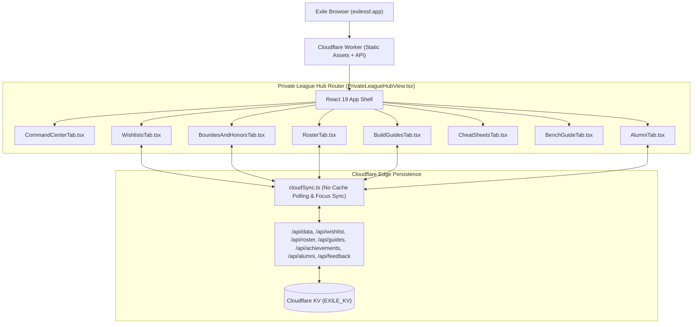

# EXILE SSF: Path of Exile 1 & 2 Compendium and GSF Portal

<div align="center">

```text
  ███████╗██╗  ██╗██╗██╗     ███████╗    ███████╗███████╗███████╗
  ██╔════╝╚██╗██╔╝██║██║     ██╔════╝    ██╔════╝██╔════╝██╔════╝
  █████╗   ╚███╔╝ ██║██║     █████╗      ███████╗███████╗█████╗  
  ██╔══╝   ██╔██╗ ██║██║     ██╔══╝      ╚════██║╚════██║██╔══╝  
  ███████╗██╔╝ ██╗██║███████╗███████╗    ███████║███████║██║     
  ╚══════╝╚═╝  ╚═╝╚═╝╚══════╝╚══════╝    ╚══════╝╚══════╝╚═╝     
```

**Live Domain:** [exilessf.app](https://exilessf.app) • **Active League:** [Ravenwatch Covens of Umbra GSF (PL87651)](https://exilessf.app/league/poe1-330-umbra) • **Platforms:** Path of Exile 1 (3.30.0d) & Path of Exile 2 (0.5 Ancients)

[](https://exilessf.app)
[](https://workers.cloudflare.com)
[](https://vitejs.dev)
[](https://react.dev)
[](https://www.typescriptlang.org)
[](https://tailwindcss.com)
[](https://www.pathofexile.com/umbra)
[](https://pathofexile2.com/ancients)

</div>

## Executive Overview

**EXILE SSF** ([exilessf.app](https://exilessf.app)) is a comprehensive educational compendium and live cloud synced Group Self Found (GSF) private league portal engineered for 10 to 60+ exiles across the entire **Path of Exile series**.

Built to replace scattered browser tabs, eliminate trade friction, and deliver deterministic game knowledge in an agile interface. Whether you are progressing Solo Self Found from Twilight Strand to 4 Voidstones or coordinating multi character loot sharing inside **Ravenwatch Covens of Umbra GSF (PL87651)**, **EXILE SSF** provides real time Cloudflare KV synchronization, incentivized item bounties, reverse drop matching, cloud persisted achievements, build diagnostics, and up to date 3.30.0d patch mechanics.

## Core Capabilities and Feature Modules

### 1. Group Self Found Private League Hub (PoE 1 & PoE 2)
Modular private league coordination portal supporting concurrent seasons (**PoE 1 3.30 Covens of Umbra** and **PoE 2 0.5 Return of the Ancients**) backed by Cloudflare KV global edge storage:
* **Command Center (`CommandCenterTab.tsx`)**: Hero launch banner, official crowdfund and slot progress trackers, live reveal and launch countdown timers, 4 step onboarding guide, Ravenwatch and NOIR Guild community hub links, editable resource links, past league archives, and collapsible FAQ accordions.
* **Wishlists, Needs, and Reverse Drop Matcher (`WishlistsTab.tsx`)**: Unified loot sharing engine with three views (`By Item`, `By Player`, and `Table`).
  * **Complete 28 Category Grouped Item Taxonomy**: Covers every Path of Exile item class grouped cleanly into Gear & Equipment, Skill & Support Gems (including Awakened and Transfigured Gems), Maps, Boss Fragments (Shaper, Elder, Maven, Uber), Scarabs, Currency & Crafting Materials (Essences, Fossils, Catalysts, Oils, Delirium Orbs, Harvest, Beasts), and League Specialty items (3.30 Threads of Creation, Divination Cards, Heist, Expedition, Tattoos, Omens, Sanctum, Ultimatum).
  * **Multi Character Farm View**: One click **`All Squad`**, **`My Needs`**, and per character filter pills (`Evil`, `Alt 2`, `Alt 3`) displaying live open need counts so players can scan exactly what each character needs during or after farming sessions.
  * **Smart Acquired State (`HAVE`)**: Items marked as `HAVE` persist immediately to Cloudflare KV, remain visible on the card grid with an emerald border sorted to the end, and filter cleanly under the `HAVE` status selector.
* **Squad Bounty Board, Fulfillment Heroes, and Cloud Achievements (`BountiesAndHonorsTab.tsx`)**: Dedicated `/bounties` page with bidirectional loopbacks to Wishlists.
  * **Incentivized Item Bounties**: Attach finder rewards (for example, `8 Divines`, `150 Chaos`, `Uber Boss Carry`, or `Craft Favor`) directly on wishlist cards or from the Bounty Board. Finders click **"I Found This: Claim Bounty"** upon drop (`CLAIMED`), and requesters or admins confirm receipt with one click (`PAID & SETTLED`).
  * **Fulfillment Heroes Leaderboard & Settlement Log**: Ranks squad providers by bounties claimed and total wishes fulfilled, with one click **"View on Wishlist"** loopbacks to any item.
  * **Cloud Persisted Achievements & Legacy Honors**: 12 tiered achievements (`Common`, `Rare`, `Unique`, `Pinnacle`) across Bounties & Coop, League Loyalty, Wishlist & Economy, and Community & Guides, stored globally in Cloudflare KV (`global:achievements`) so lifetime honor scores, unlocked badges, and equipable Legacy Titles carry over across all devices and future private league seasons.
* **Multi Character Roster Directory and Admin Controls (`RosterTab.tsx`)**:
  * **Account Slots with Unlimited Characters**: Private league slots (`5/10 Slots`) remain strictly account based while each player can register multiple characters (Main plus Alts) under their single account slot, set their primary display character, and link wishlist items directly to each character.
  * **Host and Admin Management**: Dedicated Admin Mode enabling league hosts to remove inactive players and reassign character ownership directly in the UI with instant Cloudflare KV sync.
  * **Direct Invite and Join Deep Links**: Shareable registration links (`?join=true`) with native HTML5 dialogs for frictionless squad onboarding.
* **Community Build Guides (`BuildGuidesTab.tsx`)**: Searchable, sortable community starter guides with class filter pills, upvoting, full reader mode (`FullGuideReaderView`), Path of Building links, and one click import of required uniques straight into your personal wishlist.
* **Mechanic Cheat Sheets (`CheatSheetsTab.tsx`)**: Interactive searchable reference tables covering **3.30.0c and 3.30.0d Threads of Creation Thresholds** (guaranteed modifiers and 3 to 1 vendor recipe), Betrayal Immortal Syndicate rewards, Heist Rogues, Delve Fossil biomes, Incursion Temple rooms, and Atlas Map Ratings.
* **Bench and Stash Guide (`BenchGuideTab.tsx`)**: Essential crafting bench unlock locations and prioritized stash tab buyer tiers.
* **Alumni Directory and Outreach Hub (`AlumniTab.tsx`)**: Preserves over 100 past participants across 5 historical NOIR private leagues synced in Cloudflare KV (`global:alumni`) with one click outreach actions (in game `/whisper`, Root App user tags, Discord handles, cloud synced nudge toggles) and a Clean Slate Season Reset modal.

### 2. Path of Exile 1 (3.30.0d) Patch Alignment
All PoE 1 tips, progression guides, vendor recipes, and mechanic tables reflect the full post launch 3.30 patch cycle through **3.30.0d Hotfix 2**:
* **Threads of Creation Formulas**: Applying 1 to 3 Threads guarantees at least 1 modifier; 4 to 7 Threads guarantees at least 2 modifiers; 8 or more Threads guarantees at least 3 modifiers. Any 3 unwanted Threads vendor for 1 fresh random Thread of Creation.
* **Updated League Mechanics**: Reflects post launch adjustments across all 3.30 hotfixes and patches (`3.30.0b`, `3.30.0c`, and `3.30.0d`).

### 3. Dynamic Contact Tagging System
Respects player platform preferences without forcing a single chat app:
* **Root Web App Tag**: Primary Ravenwatch and NOIR community handle (`@Leuie`)
* **In Game Whisper**: Direct character whisper commands (`/whisper CharacterName ...`) and global channel (`/global 5712`)
* **Path of Exile Account Tag**: Official GGG account identifier (`Account#1234`)
* **Optional Handles**: Discord and Steam profiles

### 4. Build Guide Ingestion, PoB Build Doctor, and Cloud Feedback Hub
* **Build Guide Ingestion Engine**: Parses `pobb.in` links, raw XML/base64 Path of Building codes, YouTube breakdowns, Maxroll, and official forum threads with automatic creator attribution.
* **PoB Build Doctor**: Client side compressed XML decoder (`pako`) evaluating elemental resistance caps (75%), Chaos resistance, physical mitigation, life pools, and spell suppression.
* **Cloud Synced Feedback and Roadmap Hub (`FeedbackView.tsx`)**: User submitted feature requests, bug reports, status badges (`Under Review`, `Planned`, `In Progress`, `Implemented`), and upvoting persisted globally in Cloudflare KV (`global:feedback`).
* **Progression Checklists and Vendor Recipes**: Act 1 through 10 walkthroughs, Atlas Voidstone progression, Lord's Labyrinth notes, and deterministic crafting recipes.

## Modular Architecture and Cloud Sync Workflow

The Private League Hub uses a clean, declarative tab router (`PrivateLeagueHubView.tsx`) that delegates domain state and rendering to eight isolated tab modules inside `src/components/league/tabs/`, paired with a Cloudflare Worker API (`worker/index.ts`) for real time KV persistence across all players.



### Project Directory Structure

```text
exile-ssf/
├── src/
│   ├── components/
│   │   ├── PrivateLeagueHubView.tsx      # Clean tab router, cloud sync engine, and global modals
│   │   ├── LeagueHeroBanner.tsx          # Dynamic PoE 1 & PoE 2 league launch banner
│   │   ├── LeagueContentManagerModal.tsx # Admin editor for quick links, archives, and FAQs
│   │   ├── FullGuideReaderView.tsx       # Interactive build guide reader with wishlist import
│   │   ├── FeedbackView.tsx              # Cloud synced community feedback & roadmap hub
│   │   └── league/
│   │       └── tabs/
│   │           ├── CommandCenterTab.tsx    # Countdowns, crowdfund bar, onboarding, archives, FAQ
│   │           ├── WishlistsTab.tsx        # 28 categories, Farm View char filter, drop matcher, bounties
│   │           ├── BountiesAndHonorsTab.tsx# Active Bounty Board, Heroes Leaderboard, Cloud Achievements
│   │           ├── RosterTab.tsx           # Account slots with multi character tracking & admin controls
│   │           ├── BuildGuidesTab.tsx      # Guide cards, search, class pills, upvotes
│   │           ├── CheatSheetsTab.tsx      # 3.30.0d Threads, Betrayal, Heist, Delve, Incursion, Maps
│   │           ├── BenchGuideTab.tsx       # Bench unlock locations & stash tab tiers
│   │           └── AlumniTab.tsx           # Cloud synced past league records & admin outreach tools
│   ├── data/                             # Static compendiums, 3.30.0d cheat sheets, initial records
│   ├── services/
│   │   └── cloudSync.ts                  # Edge KV API client for all multiplayer league & global records
│   ├── types/                            # Strict TypeScript interfaces (WishlistItemCategory, LeagueCharacter, Achievements)
│   └── utils/
│       ├── achievements.ts               # Pure cloud achievement evaluation engine (zero localStorage)
│       └── confetti.ts                   # Celebration effects
├── worker/
│   └── index.ts                          # Cloudflare Worker serving Static Assets and KV REST API
└── wrangler.jsonc                        # Cloudflare Workers deployment & EXILE_KV binding config
```

## Tech Stack

| Layer | Technology | Purpose |
| :--- | :--- | :--- |
| **Framework** | React 19.2 + TypeScript 6.0 | Strict type safe modular component architecture |
| **Build Tool** | Vite 8.2 | Rapid hot module replacement and production bundling |
| **Styling** | Tailwind CSS 3.4 | Dark gaming utility aesthetic (`bg-slate-900/80`, `border-slate-800`) |
| **Icons** | Lucide React 1.32 | Crisp interface and monospace iconography |
| **Compression** | Pako 3.0 | Client side Path of Building zlib XML decompression |
| **Dialogs** | HTML5 `<dialog>` | Native accessible modals with `closedby="any"` light dismiss |
| **Linting** | Oxlint 1.75 | High speed static analysis |
| **Hosting & Edge DB** | Cloudflare Workers + KV (`EXILE_KV`) | Global static asset delivery, SPA routing, and low latency multiplayer storage |

## Local Development Setup

1. **Clone the repository:**
   ```bash
   git clone https://github.com/Leuie/exile-ssf.git
   cd exile-ssf
   ```

2. **Install dependencies:**
   ```bash
   npm install
   ```

3. **Start the local development server:**
   ```bash
   npm run dev
   ```
   Open your browser to `http://localhost:5173/`.

4. **Verify TypeScript and Production Build:**
   ```bash
   npm run build
   ```
   This runs `tsc -b && vite build` to ensure zero type errors or unused variable warnings before deployment.

5. **Preview the production bundle:**
   ```bash
   npm run preview
   ```

## Deployment via Cloudflare Workers Static Assets

The repository deploys automatically to [exilessf.app](https://exilessf.app) via Cloudflare Workers Static Assets configured in `wrangler.jsonc`:
* **Build Command**: `npm run build` (`tsc -b && vite build`)
* **Deploy Command**: `npx wrangler deploy`
* **Static Assets Directory**: `./dist` with `single-page-application` fallback routing
* **KV Binding (`EXILE_KV`)**: Global edge namespace storing per league wishlists, multi character rosters, community guides, global player achievements (`global:achievements`), alumni directory (`global:alumni`), and community feedback (`global:feedback`) with `Cache-Control: no-store` headers for instant cross client updates.

## Community and Contributing

Built with care for **Ravenwatch** and the **NOIR Group Self Found Community**.
* **Official GSF Server**: [Ravenwatch on Root](https://rootapp.gg/AC1NPUuJiQqlyDvGbgH-8A)
* **Guild Headquarters**: [NOIR Guild HQ on Root](https://rootapp.gg/AC01VYpHiAq1rM0An8FDzw)
* **In Game Channel**: `/global 5712`
* **Feature Requests**: Submit ideas directly through the cloud synced [Feedback and Roadmap Hub](https://exilessf.app).
