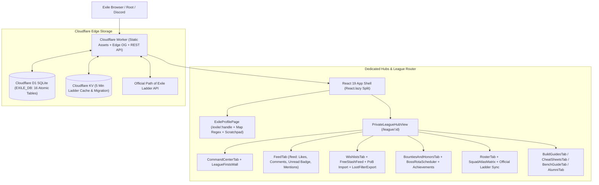

# EXILE SSF: Path of Exile 1 & 2 Compendium and GSF Portal

<div align="center">

```text
  ███████╗██╗  ██╗██╗██╗     ███████╗    ███████╗███████╗███████╗
  ██╔════╝╚██╗██╔╝██║██║     ██╔════╝    ██╔════╝██╔════╝██╔════╝
  █████╗   ╚███╔╝ ██║██║     █████╗      ███████╗███████╗█████╗  
  ██╔══╝   ██╔██╗ ██║██║     ██╔══╝      ╚════██║╚════██║██╔══╝  
  ███████╗██╔╝ ██╗██║███████╗███████╗    ███████║███████║██║     
  ╚══════╝╚═╝  ╚═╝╚═╝╚══════╝╚══════╝    ╚══════╝╚══════╝╚═╝     
```

**Live Domain:** [exilessf.app](https://exilessf.app) • **Active League:** [Ravenwatch Covens of Umbra GSF (PL87651)](https://exilessf.app/league/poe1-330-umbra) • **Platforms:** Path of Exile 1 (3.30.0d) & Path of Exile 2 (0.5 Ancients)

[](https://exilessf.app)
[](https://developers.cloudflare.com/d1/)
[](https://vitejs.dev)
[](https://react.dev)
[](https://www.typescriptlang.org)
[](https://tailwindcss.com)
[](https://www.pathofexile.com/umbra)
[](https://pathofexile2.com/ancients)

</div>

## Executive Overview

**EXILE SSF** ([exilessf.app](https://exilessf.app)) is a comprehensive educational compendium and atomic **Cloudflare D1 (SQLite)** powered Group Self Found (GSF) private league portal engineered for 10 to 60+ exiles across the **Path of Exile series**.

Built to replace scattered browser tabs, eliminate trade friction, and serve as an agile second monitor companion. Whether you are progressing Solo Self Found from Twilight Strand to 4 Voidstones or coordinating multi character loot sharing inside **Ravenwatch Covens of Umbra GSF (PL87651)**, **EXILE SSF** delivers atomic edge SQL persistence, dedicated player profile hubs (`/exile/:handle`), incentivized item bounties, boss carry vouches, one click PoE loot filter generation, live official ladder syncing, and up to date 3.30.0d patch mechanics.

## Core Capabilities and Feature Modules

### 1. Group Self Found Private League Hub (PoE 1 & PoE 2)
Modular private league coordination portal with 9 crisp single row tabs backed by **Cloudflare D1 (`EXILE_DB`)** atomic SQLite tables and **Instant Drop Check (`Alt+D`)**:
* **Command Center (`CommandCenterTab.tsx`)**: Hero launch banner, **League Firsts & Hall of Fame Wall** (8 seasonal milestones synced directly with active Roster characters and editable by winners/admins, backed by Cloudflare D1), official crowdfund and slot progress trackers, live countdown timers, 4 step onboarding guide, Ravenwatch and NOIR Guild community hub links, cloud synced resource links, past league archives, and collapsible F.A.Q. accordions.
* **Feed (`FeedTab.tsx`, `/league/:id/feed`)**: Real time league activity wall positioned right after Command Center with its own unique shareable URL and Edge OpenGraph preview.
  * **Auto Populated Activity Stream**: Automatically records when squadmates join the league, post new characters, wishlist items, list bounties, publish or update build guides, earn achievements, claim League Firsts, host Boss Rotas, post Free Stash drops, or fulfill drops for others.
  * **Likes (Hearts), 1 Line Shoutout Comments & Unread Badge**: Drop Likes and inline shoutout replies on any Feed card (saved to Cloudflare D1 `activity_feed`), track unread activity with a glowing emerald **`X new`** badge on the Feed tab (`lastSeenFeedAt` synced to D1 profiles), and filter down to **`My Squad & Mentions`** in 1 click.
* **Wishlists (`WishlistsTab.tsx`)**: Unified loot sharing engine, reverse drop matcher (`By Item`, `By Player`, `Table`, and **`Free Stash`** views), and **Ctrl+C PoE Item Tooltip Parser** (paste in game tooltips directly into Add Wanted Item, Free Stash Feed, or `Alt+D` Drop Check).
  * **28 Category Grouped Item Taxonomy**: Covers every Path of Exile item class grouped into Gear & Equipment, Skill & Support Gems (Awakened and Transfigured), Maps, Boss Fragments (Shaper, Elder, Maven, Uber), Scarabs, Currency & Crafting Materials (Essences, Fossils, Catalysts, Oils, Delirium Orbs, Harvest, Beasts), and League Specialty items (3.30 Threads of Creation, Divination Cards, Heist, Expedition, Tattoos, Omens, Sanctum, Ultimatum).
  * **Multi Character Farm View & One Click PoB Import (`PobWishlistImportModal.tsx`)**: Filter by **`All Squad`**, **`My Needs`**, or individual characters (`Evil`, `Alt 2`, `Alt 3`), or paste a Path of Building export code to extract required Uniques, Cluster Jewels, and Transfigured/Awakened Gems straight into your wishlist.
  * **"Found in My Stash / Free to Good Home" Feed (`FreeStashFeed.tsx`)**: Reverse wishlist feed backed by Cloudflare D1 (`stash_drops`) where players paste `Ctrl+C` tooltips for spare uniques or crafting bases so squadmates can claim them for alt builds.
  * **Squad Wishlist Loot Filter Generator (`LootFilterExportModal.tsx`)**: Auto generates a valid Path of Exile `.filter` override block (Gold Beam + Star Icon for active Bounties, Emerald / Cyan Beams for Squad Needs) with Copy, Download `.filter`, and a 2 tab beginner friendly setup guide for both Local `.filter` files and FilterBlade.xyz.
  * **Smart Acquired State (`HAVE`) & Receipt Confirmation Bonus**: Acquired items persist atomically to Cloudflare D1. Finding a squad item grants `+5 Honor Points`, confirming receipt grants an additional `+5 Honor Points` (`+10` total to the finder), and marking your own item Self Found grants `+5 Honor Points`.
* **Bounties (`BountiesAndHonorsTab.tsx`)**: Dedicated `/bounties` hub uniting incentivized item hunts, Boss Carries, **Squad Boss & 4 Voidstone Rotation Scheduler (`BossRotaScheduler.tsx`)**, Verified Vouches, and Achievements.
  * **Active Bounty Board**: Attach finder rewards (for example, `8 Divines`, `150 Chaos`, `Uber Boss Carry`, `Craft Favor`) directly on wishlist cards or from the Bounty Board. Claim via native dark `<dialog>` (`CLAIMED`) and confirm delivery settlement (`PAID & SETTLED`).
  * **Boss Carries, Party Up Rotas & Vouch Reputation System**: Post live portal rotations (`3/6 spots open`) with one click Claim Spot, list 4 Voidstone carries, Uber Boss kills, T17 completions, Betrayal crafts, and Lab runs, and build permanent `★ X Vouches` trust badges in Cloudflare D1.
  * **Achievements & Honor Points Ledger (Carries Over Across Seasons)**: 14 tiered achievements (`Common`, `Rare`, `Unique`, `Pinnacle`) persisted in Cloudflare D1 (`achievements` table), including the non retroactive **`Coven of Umbra (3.30) Member`** achievement featuring a custom dark fantasy **Umbra Coven Witch Medallion** icon (`public/achievements/umbra-witch-330.jpg`), plus retroactive `+25 Honor Points` for early 3.30 Private League registration pioneers, `+5` per squad item found, `+5` per confirmed delivery (`+10` total to finder), and `+5` per Self Found wishlist item.
* **Roster (`RosterTab.tsx`)**:
  * **Squad Atlas Tree & Niche Division Matrix (`SquadAtlasMatrix.tsx`)**: Visual matrix across all 10 core mechanics (Betrayal, Essences, Harvest, Expedition, Delve, Blight, Heist, Legion, Destructive Play, Ritual) highlighting unfilled squad niches and offering 1 click PoE swap whispers.
  * **Account Slots with Multi Character Tracking**: Private league slots (`5/10 Slots`) remain strictly account based while each player can register multiple characters (Main plus Alts) under their single account slot and designate wishlist items per character.
  * **Live PoE Official Ladder Sync**: One click **Sync PoE Ladder** button calling `/api/ladder` (with GGG compliant `User-Agent` and 5 minute KV cache) to auto update character levels, ascendancies, and auto discover alt characters.
  * **Host Admin Controls & Direct Links**: Admin Mode for member removal and owner reassignment, plus `?join=true` invite deep links.
* **Builds (`BuildGuidesTab.tsx`)**: Searchable, sortable community starter guides with class filter pills, upvoting, full reader mode (`FullGuideReaderView`), PoB links, and one click import of required uniques to your wishlist.
* **Cheat Sheets (`CheatSheetsTab.tsx`)**: Searchable reference tables covering **3.30.0c and 3.30.0d Threads of Creation Thresholds** (guaranteed modifiers and 3 to 1 vendor recipe), Betrayal Syndicate rewards, Heist Rogues, Delve Fossil biomes, Incursion Temple rooms, and Atlas Map Ratings.
* **Crafting Bench (`BenchGuideTab.tsx`)**: Essential crafting bench unlock locations and prioritized stash tab buyer tiers.
* **Alumni (`AlumniTab.tsx`)**: Historical directory of over 100 past participants across 5 seasons synced in Cloudflare D1 with one click outreach tools and a Clean Slate Season Reset modal.

### 2. Dedicated Exile Profile Pages (`/exile/:handle`)
Clicking `@Username` in the top right bar (or any `@handle` anywhere across the app) opens that player's shareable Exile Profile hub (`https://exilessf.app/exile/leuie`) with a deterministic Exile UID (`EXILE-XXXX`), custom linked external **Avatar Image**, inline **Edit Profile** and **Update Account** controls, bio, timezone, **Official PathOfExile.com Profile Link**, multi character roster, open wishlists and bounties, carry services, verified vouch wall, **1 Click Safe Map Regex Generator** (saved to Cloudflare D1), **Personal Farming Session Scratchpad & Upgrade Checklist** (tagged by character, saved to Cloudflare D1), achievements showcase (with custom league emblems), and full **Honor Points History Ledger** (showing when, where, and why every point was awarded), complete with custom Edge OpenGraph previews when shared in Root or Discord.

### 3. Edge OpenGraph Unfurls, Code Splitting, and Compendium Utilities
* **Dynamic Server Side OpenGraph Metadata**: `worker/index.ts` rewrites `<title>`, `<meta name="description">`, and `og:*` / `twitter:*` tags at the Cloudflare Edge for every route (including `/league/:id/feed` and `/exile/:handle`) so links shared in Root, Discord, and Slack always show accurate page specific descriptions.
* **Full Route & Tab `React.lazy` Code Splitting**: All 25 top level views and 9 league tabs load on demand for rapid initial paint.
* **Build Guide Ingestion, PoB Build Doctor, and Cloud Feedback Hub**: Client side PoB XML diagnosis (`pako`), guide ingestion, and Cloudflare D1 synced community feedback and roadmap voting.

## Modular Architecture and Cloudflare D1 Edge Stack



### Project Directory Structure

```text
exile-ssf/
├── public/
│   └── achievements/
│       └── umbra-witch-330.jpg           # Custom 3.30 Coven of Umbra Witch Medallion emblem
├── src/
│   ├── components/
│   │   ├── ExileProfilePage.tsx          # Dedicated /exile/:handle hub, Map Regex, Scratchpad, Honor Ledger
│   │   ├── PrivateLeagueHubView.tsx      # Lazy tab router, Alt+D Drop Check, Feed unread tracker
│   │   ├── LeagueHeroBanner.tsx          # Dynamic PoE 1 & PoE 2 league launch banner
│   │   ├── LeagueContentManagerModal.tsx # Admin editor for quick links, archives, and FAQs
│   │   ├── FullGuideReaderView.tsx       # Interactive build guide reader with wishlist import
│   │   ├── FeedbackView.tsx              # D1 synced community feedback & roadmap hub
│   │   └── league/
│   │       ├── modals/
│   │       │   ├── LootFilterExportModal.tsx # .filter block generator + 2 tab setup guide
│   │       │   └── PobWishlistImportModal.tsx# 1 click PoB code unique/cluster/gem importer
│   │       ├── widgets/
│   │       │   ├── SquadAtlasMatrix.tsx      # 10 mechanic GSF farming matrix + 1 click swap whispers
│   │       │   ├── FreeStashFeed.tsx         # Reverse wishlist free drop feed + Ctrl+C tooltip cards
│   │       │   ├── BossRotaScheduler.tsx     # Party Up portal rotation scheduler
│   │       │   ├── LeagueFirstsWall.tsx      # Roster synced seasonal Hall of Fame milestones
│   │       │   ├── MapRegexBuilder.tsx       # 1 click safe T16/T17 map regex builder (D1 saved)
│   │       │   └── SessionScratchpad.tsx     # Character tagged farming session checklist (D1 saved)
│   │       └── tabs/
│   │           ├── CommandCenterTab.tsx    # Countdowns, League Firsts, crowdfund, onboarding, FAQ
│   │           ├── FeedTab.tsx             # Live activity wall, Likes, Shoutout Comments, Mentions
│   │           ├── WishlistsTab.tsx        # 28 categories, Farm View, Free Stash, PoB Import, Receipts
│   │           ├── BountiesAndHonorsTab.tsx# Bounties, Boss Carries, Rotas, Vouches, Achievements
│   │           ├── RosterTab.tsx           # Squad Atlas Matrix, multi char slots, Live Ladder Sync
│   │           ├── BuildGuidesTab.tsx      # Guide cards, search, class pills, upvotes
│   │           ├── CheatSheetsTab.tsx      # 3.30.0d Threads, Betrayal, Heist, Delve, Incursion, Maps
│   │           ├── BenchGuideTab.tsx       # Bench unlock locations & stash tab tiers
│   │           └── AlumniTab.tsx           # D1 synced past league records & admin outreach tools
│   ├── data/                             # Static compendiums, 3.30.0d cheat sheets, initial records
│   ├── services/
│   │   └── cloudSync.ts                  # Edge D1 API client for all multiplayer & profile records
│   ├── types/                            # Strict TypeScript interfaces
│   └── utils/
│       ├── achievements.ts               # Cloud achievement & retroactive Honor Ledger engine
│       ├── poeItemParser.ts              # Ctrl+C PoE tooltip parser & PoB zlib XML extractor
│       └── confetti.ts                   # Celebration effects
├── worker/
│   ├── index.ts                          # Cloudflare Worker (D1 SQLite API, PBKDF2 Auth, Ladder, Edge OG)
│   └── schema.sql                        # Canonical 16 table Cloudflare D1 SQLite schema
└── wrangler.jsonc                        # Cloudflare Workers deployment, EXILE_DB (D1) & EXILE_KV
```

## Tech Stack

| Layer | Technology | Purpose |
| :--- | :--- | :--- |
| **Framework** | React 19.2 + TypeScript 6.0 | Strict type safe lazy loaded modular architecture |
| **Build Tool** | Vite 8.2 | Rapid hot module replacement and chunked production builds |
| **Styling** | Tailwind CSS 3.4 | Dark gaming utility aesthetic (`bg-slate-900/80`, `border-slate-800`) |
| **Icons** | Lucide React 1.32 | Crisp interface and monospace iconography |
| **Compression** | Pako 3.0 | Client side Path of Building zlib XML decompression |
| **Dialogs** | HTML5 `<dialog>` | Native accessible dark modals with `closedby="any"` light dismiss |
| **Database** | Cloudflare D1 (`EXILE_DB`) | Atomic SQLite edge storage across 16 relational tables |
| **Cache & Edge** | Cloudflare Workers + KV (`EXILE_KV`) | Static SPA hosting, Edge OpenGraph injection, and 5 min PoE Ladder cache |

## Local Development Setup

1. **Clone the repository:**
   ```bash
   git clone https://github.com/Leuie/exile-ssf.git
   cd exile-ssf
   ```
2. **Install dependencies:**
   ```bash
   npm install
   ```
3. **Start the local development server:**
   ```bash
   npm run dev
   ```
4. **Verify TypeScript and Production Build:**
   ```bash
   npm run build
   ```

## Community and Contributing

Built with care for **Ravenwatch** and the **NOIR Group Self Found Community**.
* **Official GSF Server**: [Ravenwatch on Root](https://rootapp.gg/AC1NPUuJiQqlyDvGbgH-8A)
* **Guild Headquarters**: [NOIR Guild HQ on Root](https://rootapp.gg/AC01VYpHiAq1rM0An8FDzw)
* **In Game Channel**: `/global 5712`
* **Feature Requests**: Submit ideas directly through the D1 synced [Feedback and Roadmap Hub](https://exilessf.app).
