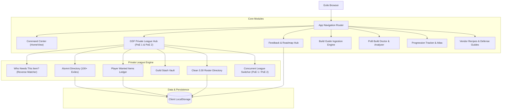

# EXILE SSF — Path of Exile 1 & 2 Compendium and GSF Portal

<div align="center">

```text
  ███████╗██╗  ██╗██╗██╗     ███████╗    ███████╗███████╗███████╗
  ██╔════╝╚██╗██╔╝██║██║     ██╔════╝    ██╔════╝██╔════╝██╔════╝
  █████╗   ╚███╔╝ ██║██║     █████╗      ███████╗███████╗█████╗  
  ██╔══╝   ██╔██╗ ██║██║     ██╔══╝      ╚════██║╚════██║██╔══╝  
  ███████╗██╔╝ ██╗██║███████╗███████╗    ███████║███████║██║     
  ╚══════╝╚═╝  ╚═╝╚═╝╚══════╝╚══════╝    ╚══════╝╚══════╝╚═╝     
```

**Live Domain:** [exilessf.app](https://exilessf.app) • **Platform:** Path of Exile 1 (3.30 Coven of Umbra) & Path of Exile 2 (0.5 Ancients)

[](https://exilessf.app)
[](https://vitejs.dev)
[](https://react.dev)
[](https://www.typescriptlang.org)
[](https://tailwindcss.com)
[](https://www.pathofexile.com/umbra)
[](https://pathofexile2.com/ancients)

</div>

---

## Executive Overview

**EXILE SSF** ([exilessf.app](https://exilessf.app)) is an all in one educational compendium and cooperative Group Self Found (GSF) private league portal engineered for exiles across the entire **Path of Exile series**. 

Designed to replace dozens of scattered browser tabs, eliminate trade burnout, and empower exiles with deterministic game knowledge. Whether you are progressing Solo Self Found on twilight beach, tackling 4 Voidstones, or playing in our cooperative community private leagues, **EXILE SSF** provides verified blueprints, drop matching, build diagnosis, and league onboarding.

---

## Core Capabilities & Feature Modules

### 1. Group Self Found Private League Hub (PoE 1 & PoE 2)
Complete private league coordination portal supporting concurrent seasons (**3.30 Coven of Umbra** and **PoE 2 0.5 Return of the Ancients**):
- **Command Center**: Live countdown timers for the ExileCon reveal livestream and official expansion launch, crowdfunding progress indicators, and slot trackers.
- **Roster Directory**: Roster management with planned builds, launch day availability, and ascendancy distribution.
- **Who Needs This Item? (Reverse Drop Matcher)**: Solves the classic problem of finding high tier loot in maps and wondering which squad mate needs it. Aggregates all registered player wishlists so you can search any item name and instantly identify who needs it, their preferred contact handle, and copy an in game whisper command with 1 click.
- **Wishlists & Needs**: Exiles post wanted uniques, transfigured skill gems, divination cards, and crafting bases with need priorities (`NEED`, `HAVE`, `SECOND CHAR`, `LOW PRIO`).
- **Guild Stash Vault**: Ledger of leveling uniques and crafting bases deposited into shared guild stash tabs.
- **Clean Slate & Season Reset**: Admins can reset active sheets for new league launches with confirmation dialogs while automatically archiving exiles into the Alumni directory.

### 2. Alumni Directory & Admin Outreach Engine
- Preserves past participants across 5 historical private leagues with the community badge:
  > *"We have run previous leagues with over 100 participants across 5 past leagues."*
- **1 Click Outreach Actions**: Copy In Game Whisper (`/whisper IGN ...`), Copy Root App User Tag (`@DisplayName`), Copy Discord Handle, and toggle Nudge Checkmarks.
- **Batch Admin Tools**: "Copy All Alumni Account Names" (formatted for Path of Exile private league invite ladders) and "Copy 3.30 Announcement Template".

### 3. Dynamic Contact Tagging System
Respects exile platform preferences without assuming everyone uses Discord:
- **Root Web App User Tag**: Site profile handle (`@Leuie`)
- **In Game Whisper**: Direct character whisper commands (`@CharacterName ...`)
- **Path of Exile Account Tag**: Official account identifier (`Account#1234`)
- **Optional Handles**: Discord and Steam community profiles

### 4. Community Feedback, Needs & Roadmap Hub
- A dedicated board where users can submit feature requests, website improvements, private league tool needs, and bug reports.
- Category filters, status indicators (`Under Review`, `Planned`, `In Progress`, `Implemented`), upvoting with confetti celebrations, and official admin responses.

### 5. Build Guide Ingestion & Import Engine
- Ingests community guides from `pobb.in`, raw XML/base64 Path of Building codes, YouTube video breakdowns, Maxroll, and official PoE forum threads.
- **Creator Attribution**: Automatically generates verified creator badges and backlinks to original channels (e.g., Subtractem, Zizaran, GhazzyTV, Palsteron, Ruetoo, Pohx).
- Supports both full interactive on site guides and external guide quick link references with live previews.

### 6. PoB Build Doctor & Analyzer
- Import Path of Building share codes or select from curated SSF league starter presets.
- Decodes compressed XML data client side without remote servers.
- Evaluates elemental resistance caps (75%), Chaos resistance benchmarks, physical mitigation layers, life pools, and spell suppression.

### 7. Game Systems, Mechanics & Offline Utilities
- **Vendor Formula Compendium**: Verified recipes for early gem links, weapon physical/caster damage upgrades, socket manipulation, and currency exchange.
- **Progression Checklists**: Daily and weekly progression milestones from Act 1 beach to Uber pinnacle bosses.
- **Cheat Sheets**: Quick reference tables for Immortal Syndicate Betrayal rewards, Heist rogues, Delve fossil biomes, and Incursion temple rooms.

---

## Architectural Workflow



---

## Tech Stack

| Layer | Technology | Purpose |
| :--- | :--- | :--- |
| **Framework** | React 19 + TypeScript | Type safe component architecture |
| **Build Tool** | Vite 6.0 | Sub second hot module replacement & minification |
| **Styling** | Tailwind CSS 3.4 | Subdued dark gaming utility aesthetic (`bg-slate-900/80`, `border-slate-800`) |
| **Icons** | Lucide React | High density monospace and interface iconography |
| **Dialogs** | HTML5 `<dialog>` | Native modal dialogs with `closedby="any"` light dismiss compliance |
| **Domain & CDN** | Cloudflare Pages / GitHub Pages | Edge caching, automated SSL, custom domain routing (`exilessf.app`) |

---

## Local Development Setup

1. **Clone the repository:**
   ```bash
   git clone https://github.com/<your-username>/exile-ssf.git
   cd exile-ssf
   ```

2. **Install dependencies:**
   ```bash
   npm install
   ```

3. **Start the local development server:**
   ```bash
   npm run dev
   ```
   Open your browser to `http://localhost:5173/`.

4. **Verify TypeScript & Production Build:**
   ```bash
   npm run build
   ```

5. **Preview the production bundle:**
   ```bash
   npm run preview
   ```

---

## Publishing to exilessf.app via Cloudflare

1. **Connect GitHub to Cloudflare Pages:**
   - Log into your [Cloudflare Dashboard](https://dash.cloudflare.com/)
   - Go to **Workers & Pages** > **Create application** > **Pages** > **Connect to Git**
   - Select the `exile-ssf` repository
2. **Configure Build Settings:**
   - **Framework preset**: `Vite`
   - **Build command**: `npm run build`
   - **Build output directory**: `dist`
3. **Add Custom Domain:**
   - In your Cloudflare Pages project, go to **Custom domains** > **Set up a custom domain**
   - Enter `exilessf.app`
   - Because your domain was purchased on Cloudflare, DNS records and SSL certificates are provisioned automatically in seconds!

---

## Contributing & Community

Built with care for the **NOIR Group Self Found Community** and exiles worldwide. For suggestions, submit a request directly through the on site [Feedback & Roadmap Hub](https://exilessf.app) or connect on Discord in `#poe-chat`.
