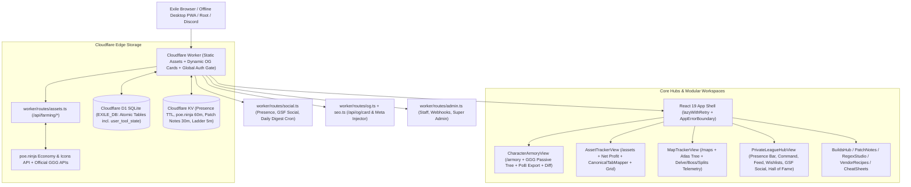

# EXILE SSF: Path of Exile 1 & 2 Compendium, Character Armory, Asset & Map Trackers, and GSF Portal

<div align="center">

```text
  ███████╗██╗  ██╗██╗██╗     ███████╗    ███████╗███████╗███████╗
  ██╔════╝╚██╗██╔╝██║██║     ██╔════╝    ██╔════╝██╔════╝██╔════╝
  █████╗   ╚███╔╝ ██║██║     █████╗      ███████╗███████╗█████╗  
  ██╔══╝   ██╔██╗ ██║██║     ██╔══╝      ╚════██║╚════██║██╔══╝  
  ███████╗██╔╝ ██╗██║███████╗███████╗    ███████║███████║██║     
  ╚══════╝╚═╝  ╚═╝╚═╝╚══════╝╚══════╝    ╚══════╝╚══════╝╚═╝     
```

**Live Domain:** [exilessf.app](https://exilessf.app) • **Version:** `v3.40.0` • **Platforms:** Path of Exile 1 (3.30 Covens of Umbra) & Path of Exile 2 (0.5 Return of the Ancients)

[](https://exilessf.app)
[](https://developers.cloudflare.com/d1/)
[](https://vitejs.dev)
[](https://react.dev)
[](https://www.typescriptlang.org)
[](https://tailwindcss.com)
[](https://www.pathofexile.com/umbra)
[](https://pathofexile2.com/ancients)

</div>

## Executive Overview

**EXILE SSF** ([exilessf.app](https://exilessf.app)) is an installable, Offline Ready desktop PWA and dual game **Path of Exile 1 & Path of Exile 2** Solo Self Found compendium, **Character Armory**, **Asset & Map Tracker**, and **Cloudflare D1** powered **Private League & GSF Hub** engineered for solo players and cooperative Group Self Found squads.

Built as a cohesive second monitor farming cockpit, **EXILE SSF** unites a single **Unified Tool Setup** wizard (shared `POESESSID` + `Client.txt`), draggable/resizable **Workspace Grids**, an interactive **Official GGG Passive & Atlas Skill Tree** suite, live stash net profit analytics, realtime `Client.txt` map & Delve XP telemetry, cooperative GSF social tooling, dynamic **Open Graph Share Cards**, and hardened HMAC signed session security.

## Core Capabilities and Feature Modules

### 1. Character Armory (`/armory`) & Build Intelligence
Full width character inspector (`CharacterArmoryView.tsx`, `src/components/armory/*`, `src/utils/pobEncoder.ts`):
* **Equipment Paperdoll & Socketed Gems**: Live GGG gear sync with full item tooltips, Prefix/Suffix affix tiers, Cluster/Abyss jewels, flasks, and a draggable/resizable `<ToolWidgetGrid />`.
* **Official GGG Passive Skill Tree Canvas**: Interactive pan/zoom canvas rendered with official `web.poecdn.com` sprite sheets, curved orbit arcs, Class Ascendancies in home quadrants, and Bloodline Ascendancies.
* **Live PoB XML Export (`Copy PoB Code`)**: 1 click Path of Building import string generator (`pako` compressed XML) exporting character class, level, equipped items, sockets, gems, and passive tree hashes.
* **Gem Level & Quality Audit**: Automatically flags Lv 20 GCP vendor recipes, 20/20 Vaal/Double Corrupt candidates, and Exceptional/Awakened gem pushes.
* **Build Upgrade Advisor & Gear Hole Detector**: Ranked slot by slot audit catching missing Eldritch implicits, un-anointed Amulets, open crafting bench affixes, low life rolls, and uncapped resistances.
* **Side by Side Character & Passive Tree Diff Viewer**: Compare vitals, Keystones, gear slots, and color coded passive tree pathing (Gold shared / Cyan yours / Purple theirs) against any alt or Private League squadmate.

### 2. Asset Tracker (`/assets`), Wealth Analytics (`/assets/analytics`) & Map Tracker (`/maps`)
Unified second monitor farming workspaces (`AssetTrackerView.tsx`, `WealthAnalyticsView.tsx`, `MapTrackerView.tsx`, `src/components/assets/*`, `src/components/maps/*`, `worker/routes/assets.ts`):
* **Asset Tracker (`/assets`)**: Standardized **18 Slot Canonical Tab Mapper** (12 specialty tabs + Levelling Items Quad + Dump 1 to 5), draggable `<ToolWidgetGrid />`, **Map Cost vs Profit Net Calculator** (subtracts Scarab, Map Device, and Chisel costs to compute **True Net Div/hr** and ROI %), **3 pure SVG charts** (Interactive Wealth Timeline, Category Share Donut, Top Yielding Tabs), live **`poe.ninja`** pricing with **`SSF Utility`** toggle + customizable **Weights** drawer, clickable **PoE Wiki** links, wall clock background safe `15m / 30m / 60m` auto sync, per league cloud persistence, opt in Hall of Fame Wealth Ladder publishing, and `.xlsx` export.
* **Full Page Wealth & Pace Analytics (`/assets/analytics`)**: Executive dashboard with per league switcher, 5 KPI cards, interactive Wealth Timeline, Category Breakdown Donut + Table, Top Yielding Tabs Leaderboard, and Top 12 Most Valuable Assets.
* **Map Tracker (`/maps`) & Interactive Atlas Skill Tree Planner**:
  * **Official GGG Atlas Skill Tree Planner**: Powered by `grindinggear/atlastree-export` with official sprites, curved orbits, Exarch/Eater backgrounds, Gateways, **150 point cap** (`132 + 18 Maven`), **BFS shortest path auto allocation**, **1 click branch refunds** with gold/red hover previews, PoE style **`Show Stats` modifier totalizer**, Linked Strategy Profiles, and 1 click **Shareable Atlas Tree links**.
  * **Realtime `Client.txt` Telemetry & Delve XP**: Per map duration, hideout downtime %, death tracking, first class **Delve (`Azurite Mine`)** classification + `Delve (Azurite Mine XP)` strategy preset, live GGG character experience **XP/hr polling** (`/api/farming/character-xp`), and opt in **`Share Live Zone`** heartbeat for the Squad Presence Bar.
  * **Specialized Telemetry Suite**: **Live Boss Rush & Invitation Tracker** (Guardians, Conquerors, Maven, Eater/Exarch, T17s), **LiveSplit Campaign Speedrun Split Comparator** (Act 1 to 10 PBs with green/red deltas), and **Delve XP / Peak Monster Lv, Sanctum & Heist** deep sub trackers.

### 3. Private League & GSF Social Hub (`/privateleaguehub` & `/league/:id`)
Cooperative Group Self Found hub for hosting and running any Path of Exile 1 or Path of Exile 2 private league:
* **Live Squad Presence Bar (`Mapping Now`)**: Real time status strip showing which squadmates are currently in T16s, Delve, Bosses, Heist, or Hideout.
* **GSF Social Tab (`/social`)**:
  * **GSF Item Loan & Return Tracker**: Log borrowed chase uniques (Mageblood, Headhunter, Defiance of Destiny) with owner, borrower, notes, and 1 click Mark Returned history.
  * **Squad Craft & Fracture Queue**: Request Veiled Orbs, Betrayal benches, Harvest augments, or Fracturing Orb attempts with material readiness flags and crafter claiming.
  * **5x5 Private League Bingo & Race Challenges**: 25 tile interactive bingo board with automatic row/column/diagonal Bingo scoring and a live squad leaderboard.
* **Wishlists, Free Stash & Loot Filter / Regex Sync**: Official item icons (`poe.ninja` CDN), **3,541 item live autocomplete**, `Ctrl+C` tooltip parser, PoB wishlist importer, reverse Free Stash Feed, and 1 click **Neversink / FilterBlade `.filter` + `<=250` char Stash Regex generator** from open Squad Wishlists.
* **Command Center, Live Feed, Bounties, Roster, 25 Mechanic Matrix, Hall of Fame & Staff Governance**: Embedded league reveal videos, automated 12 hour ladder sync, Bounties & Boss Rotas, persistent cross season Achievements & Honor Points, per league Host & Moderator console (`/manage`), and **Automated 8 PM Discord / Root Daily League Digests** (scheduled Cron Worker + manual **`Send Daily Digest Now`** button).

### 4. Compendium, Exile Profiles (`/exile/:handle`), Dynamic OG Cards & Offline PWA
* **Dynamic Open Graph Share Cards (`/api/og/card`)**: Auto generated 1200×630 dark fantasy preview cards injected into `/exile/:handle`, `/armory/:handle`, `/league/:id/hall-of-fame`, and shared Atlas links when pasted into Discord or Root, plus a 1 click **Share Card** button on Exile Profiles.
* **Offline Ready Desktop PWA Mode**: Upgraded Service Worker (`public/sw.js`) with Stale While Revalidate static caching and offline SPA fallback for **Cheat Sheets**, **Vendor Recipes**, and **Regex Studio**, desktop jump list shortcuts (`manifest.webmanifest`), and a 1 click **`Install Desktop App`** button + live **Offline Mode** indicator in the Sidebar.
* **Unified Builds Hub (`/builds`), Official Patch Notes (`/patch-notes`) & Compendium**: Live Mobalytics/Maxroll puller, PoB Build Doctor, live GGG patch notes with EST timestamps, cloud synced **Regex Studio**, **Defenses Masterclass** EHP Calculator, **Offenses** pipeline, **Sabrewulf Crafting Bench**, **Campaign & Lab** checklists, **Ctrl+K Quick Finder**, and live **GGG NZDT/NZST + Local Timezone** clock.
* **Security & Privacy (`/privacy`)**: Unified `POESESSID` manager (`src/utils/poeSession.ts`) with permanent one time disclaimer, strict HMAC SHA256 signed `HttpOnly; Secure; SameSite=Lax` `exile_session` cookie enforced globally on all state changing routes, and automatic Vite chunk reload recovery (`lazyWithRetry` + `AppErrorBoundary`).

## Modular Architecture and Cloudflare Edge Stack



### Key Directories

```text
exile-ssf/
├── public/
│   ├── manifest.webmanifest                # Standalone PWA metadata & desktop jump list shortcuts
│   ├── sw.js                               # Offline-ready SWR Service Worker (Cheat Sheets, Recipes, Regex)
│   └── achievements/umbra-witch-330.jpg    # Custom 3.30 Coven of Umbra Witch Medallion
├── src/
│   ├── components/
│   │   ├── CharacterArmoryView.tsx         # Paperdoll, GGG Passive Tree, PoB Export, Gem Audit, Upgrade Advisor, Diff
│   │   ├── AssetTrackerView.tsx            # 18-tab stash scanner, Net Profit Calculator, SVG analytics, Grid
│   │   ├── WealthAnalyticsView.tsx         # Full-page Wealth & Pace executive dashboard
│   │   ├── MapTrackerView.tsx              # Client.txt Live Watch, Atlas Tree Planner, Delve XP, Boss Rush, Splits
│   │   ├── PrivateLeagueHubView.tsx        # League Hub, Squad Presence Bar, Wishlists, Bounties, GSF Social, Manage
│   │   ├── ExileProfilePage.tsx            # Cross-game /exile/:handle passport & Share Card preview
│   │   ├── ToolSetupModal.tsx              # Unified 3-step POESESSID & Client.txt setup wizard
│   │   ├── armory/                         # PassiveTreeCanvas, GemAuditPanel, BuildUpgradeAdvisor, CharacterDiffModal
│   │   ├── assets/                         # assetEngine, CanonicalTabMapper, MapCostCalculatorWidget, WeightsEditor
│   │   ├── maps/                           # AtlasSkillTreePlanner, SpecializedTelemetrySuite, MapAnalyticsCharts
│   │   ├── league/                         # GsfSocialTab, SquadPresenceBar, WishlistsTab, WishlistFilterExportModal
│   │   └── common/                         # ToolWidgetGrid (draggable/resizable/collapsible workspace cards)
│   ├── data/
│   │   ├── plannedRoadmap.ts               # Public Roadmap tracker (100% shipped through v3.40.0)
│   │   └── siteChangelog.ts                # Timestamped release history
│   └── utils/
│       ├── pobEncoder.ts                   # Live Character -> Path of Building XML/zlib encoder
│       ├── poeSession.ts                   # Unified local POESESSID & one-time disclaimer helper
│       ├── activeCharacter.ts              # Shared Active Character & Linked Strategy Profile context
│       ├── spreadsheetEngine.ts            # Zero-dependency styled multi-tab .xlsx builder
│       └── poeItemParser.ts                # Ctrl+C tooltip parser & PoB decoder
├── worker/
│   ├── index.ts                            # Cloudflare Worker, Global Auth Gate, D1 schema, Cron scheduler
│   └── routes/
│       ├── assets.ts                       # /api/farming/* (Stash, poe.ninja, Character XP, Cloud State)
│       ├── social.ts                       # /api/league/presence, /api/league/social, Daily Digest cron & trigger
│       ├── og.ts                           # /api/og/card dynamic 1200x630 Open Graph SVG preview cards
│       ├── seo.ts                          # Dynamic HTML meta & og:image / twitter:image injector
│       └── admin.ts                        # Staff governance, per-league webhooks, Super Admin console
└── wrangler.jsonc                          # Cloudflare Workers config (EXILE_DB D1, EXILE_KV, 10m Cron)
```

## Tech Stack

| Layer | Technology | Purpose |
| :--- | :--- | :--- |
| **Framework** | React 19.2 + TypeScript 6.0 | Strict type safe code split architecture with automatic chunk recovery |
| **Build Tool** | Vite 8.2 | Fast HMR and chunked production bundles |
| **Styling** | Tailwind CSS 3.4 | Unified dark obsidian utility theme |
| **Database** | Cloudflare D1 (`EXILE_DB`) | Atomic SQLite edge storage for league data, armory snapshots, wishlists, and `user_tool_state` |
| **Cache & Cron** | Cloudflare Workers + KV (`EXILE_KV`) | Dynamic OG cards, Squad Presence heartbeats, 60m `poe.ninja` cache, Ladder & 8 PM Daily Digest Cron |
| **Offline PWA** | Service Worker + Web App Manifest | Standalone desktop app install, jump list shortcuts, offline Cheat Sheets / Recipes / Regex |
| **Security** | HMAC SHA256 `exile_session` | `HttpOnly; Secure; SameSite=Lax` cookies enforced on all state changing API routes |

## Local Development Setup

1. **Clone and install:**
   ```bash
   git clone https://github.com/Leuie/exile-ssf.git
   cd exile-ssf
   npm install
   ```
2. **Start local dev server:**
   ```bash
   npm run dev
   ```
3. **Verify TypeScript & build:**
   ```bash
   npm run build
   ```
