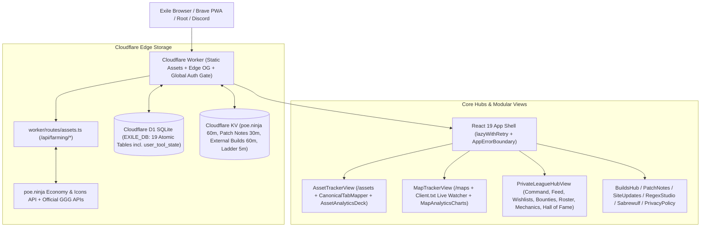

# EXILE SSF: Path of Exile 1 & 2 Compendium, Asset & Map Trackers, and GSF Portal

<div align="center">

```text
  ███████╗██╗  ██╗██╗██╗     ███████╗    ███████╗███████╗███████╗
  ██╔════╝╚██╗██╔╝██║██║     ██╔════╝    ██╔════╝██╔════╝██╔════╝
  █████╗   ╚███╔╝ ██║██║     █████╗      ███████╗███████╗█████╗  
  ██╔══╝   ██╔██╗ ██║██║     ██╔══╝      ╚════██║╚════██║██╔══╝  
  ███████╗██╔╝ ██╗██║███████╗███████╗    ███████║███████║██║     
  ╚══════╝╚═╝  ╚═╝╚═╝╚══════╝╚══════╝    ╚══════╝╚══════╝╚═╝     
```

**Live Domain:** [exilessf.app](https://exilessf.app) • **Platforms:** Path of Exile 1 (3.30 Covens of Umbra) & Path of Exile 2 (0.5 Return of the Ancients)

[](https://exilessf.app)
[](https://developers.cloudflare.com/d1/)
[](https://vitejs.dev)
[](https://react.dev)
[](https://www.typescriptlang.org)
[](https://tailwindcss.com)
[](https://www.pathofexile.com/umbra)
[](https://pathofexile2.com/ancients)

</div>

## Executive Overview

**EXILE SSF** ([exilessf.app](https://exilessf.app)) is a dual game **Path of Exile 1 and Path of Exile 2** Solo Self Found compendium, **Farming & Drop Tracker**, and **Cloudflare D1 (SQLite)** powered **Private League Hub** engineered for both solo players and cooperative Group Self Found (GSF) communities.

Built to serve as a fast second monitor companion, **EXILE SSF** combines live stash dump tab diffing, customizable `SSF Utility` and `poe.ninja` drop tiering, local `Client.txt` map speed telemetry, official GGG patch notes, unified community builds, `poe.re` / `poe2.re` regex tooling, dedicated Exile Profiles (`/exile/:handle`), and hardened HMAC signed session security.

## Core Capabilities and Feature Modules

### 1. Asset Tracker (`/assets`), Wealth Analytics (`/assets/analytics`) & Map Tracker (`/maps`)
Split into focused second monitor workspaces (`AssetTrackerView.tsx`, `WealthAnalyticsView.tsx`, `MapTrackerView.tsx`, `src/components/assets/*`, `src/components/maps/*`, and `worker/routes/assets.ts`):
* **Asset Tracker (`/assets`)**: Standardized **18 Slot Canonical Tab Mapper** (12 specialty tabs + Levelling Items Quad + Dump 1 to 5, with Auto Match, `Not Owned / Omit` hiding, and Maps/Uniques GGG API notice), **3 pure SVG charts** (Interactive Wealth Timeline, Category Share Donut, Top Yielding Tabs), default current challenge league **`poe.ninja`** pricing (`/poe1/api/economy`) with **`SSF Utility`** toggle + customizable **Weights** drawer, deep sorting and filtering for **Gems**, **Flasks**, **Div Cards**, **Uniques**, **Essences**, **Maps**, and **Gear**, clickable **PoE Wiki** links on every item name, opt in local `POESESSID` with 30 day disclaimer memory, wall clock background safe `15m / 30m / 60m` auto sync, per league Cloudflare D1 cloud stash persistence (`byLeague`), opt in Hall of Fame Wealth Ladder publishing, collapsible **What Is This?** guide, and `.xlsx` export.
* **Full Page Wealth & Pace Analytics (`/assets/analytics`)**: Dedicated full page executive dashboard with **Back to Asset Tracker** and **Exile Profile** backlinks, per league D1 switcher, 5 KPI cards (Total Net Worth, Div/hr & Chaos/hr Pace, Timeline Growth, S/A Tier Drops, Top Yielding Tab), full width interactive Wealth Timeline (Live Checkpoints & Saved Sessions toggle), Category Breakdown Donut + Table, Top Yielding Tabs Leaderboard, and Top 12 Most Valuable Assets showcase.
* **Map Tracker (`/maps`)**: Dedicated realtime **`Client.txt`** mapping telemetry with a collapsible **What Is This?** guide, **3 step setup walkthrough**, **custom Start Date calendar modal**, PoE 1 & PoE 2 strategy presets (`Campaign`, `Alch & Go White/Yellow/Red`, `Waystones T1 to T15`, `Towers`), per map duration, hideout downtime %, death tracking, special zone tagging, **automatic GGG character experience XP/hr polling** grouped by league (`/api/farming/character-xp`), **Live XP/hr & Atlas Strategy Comparison SVG charts**, Cloudflare D1 cloud history, and an in game **Timekeeper's Map Device** speedrun tip callout.

### 2. Private League Hub (`/privateleaguehub` & `/league/:id`)
Universal cooperative GSF hub for hosting and managing any Path of Exile 1 or Path of Exile 2 private league:
* **Command Center & Live Feed (`/feed`)**: Embedded **ExileCon 2026 Keynote** & **3.30 Covens of Umbra Launch** videos, crowdfund progress, Likes, inline shoutout comments, unread `X new` badge, and Discord/Root webhook alerts.
* **Wishlists, Free Stash & Loot Filter Generator**: Official **Path of Exile item icons** in the top right of every Wishlist card (via live `poe.ninja` CDN mapping + `?scope=icons` caching), **3,541 item live autocomplete** with icon previews in the Add Wanted Item modal, 28 category taxonomy, `Ctrl+C` tooltip parser, Path of Building wishlist importer (`pako`), reverse Free Stash Feed, and `.filter` block generator.
* **Bounties, Boss Rotas & Legacy Honors**: Prominent command ribbon sub navigation uniting Active Bounties, Boss Carries & Vouches, Fulfilled Wishes & Heroes, and persistent cross season Achievements & Honor Points.
* **Roster, Dedicated 25 Mechanic Atlas Matrix (`/mechanics`) & Hall of Fame (`/hall-of-fame`)**: Focused Roster view with **automatic 12 hour official ladder sync** until league expiration; dedicated **Mechanics** tab covering all **25 Atlas & Endgame mechanics** (including Bestiary, Abyss, Beyond, Torment, Settlers, and more) with one click Claim / Drop lane syncing to D1; and a dedicated **Hall of Fame** tab combining **League Firsts** milestones with an **Opt In Wealth & Pace Ladder** (Gold/Silver/Bronze podium, Headline Drops, inline sparklines, and sortable Net Worth / Pace / Maps / XP standings pulled from Asset Tracker and Map Tracker).

### 3. Universal Compendium, Builds Hub & External Portals (PoE 1 & PoE 2 Parity)
* **Unified Builds Hub (`/builds`)**: Collapsible **What Is This?** guide, condensed `All Builds & Guides` directory with `SSF Starters Only` filter, minimum guide detail gate, zero fake likes/ratings, live **Mobalytics & Maxroll.gg** build puller (`/api/builds/external`), Guide Ingestion, and **PoB Build Doctor** featuring a live **`pobb.in` / `pastebin.com` URL resolver** (`/api/pob/resolve`), parsed vitals strip, and **one click Sync to Private League Roster** (Main or Alt).
* **Official Patch Notes (`/patch-notes`) & Changelog & Feedback (`/feedback`)**: Live GGG forum feed with grouped expansion dropdown and **EST post & edit timestamps**; plus a matching **Changelog & Feedback** release reader with real community requests (zero fake posts).
* **Cloud Synced Tools (`user_tool_state` in Cloudflare D1)**: Shared **ExternalPortalFrame** powering PoE Wiki, PoEDB, live current league PoE Ninja, and **Sabrewulf.net** interactive Crafting Bench with dynamic `My Character & Wishlist` quick lookups; cloud synced **Regex Studio** presets + auto safe map regex generator; **Defenses Masterclass** EHP Calculator with **Load My League PoB Stats**; **Atlas Voidstone & Bonus Tracker**; searchable **Crafting Bench** unlock checklist; **Campaign & Lab** cloud checklists; **Tools Directory** pinned favorites; and a live **GGG NZDT/NZST + Local Timezone** clock in the Sidebar footer.

### 4. Dedicated Exile Profiles (`/exile/:handle`) & Privacy Policy (`/privacy`)
* **Cross Game Profiles**: `All Games | PoE 1 | PoE 2` switcher, Profile Studio, **Farming Telemetry & Season Trophy Case**, Safe Mapping Regex Generator, Session Scratchpad, and Honor Points History Ledger.
* **Security & Privacy (`/privacy`)**: Strict HMAC SHA256 signed `HttpOnly; Secure; SameSite=Lax` `exile_session` cookie enforced globally on all state changing `POST`, `PUT`, and `DELETE` Worker routes, owner/admin verification, transparent opt in local `POESESSID` + 30 day disclaimer policy, unified `font-cinzel` typography site wide, and automatic Vite chunk reload recovery (`lazyWithRetry` + `AppErrorBoundary`).

## Modular Architecture and Cloudflare D1 Edge Stack



### Key Directories

```text
exile-ssf/
├── public/
│   ├── manifest.webmanifest                # Standalone PWA installation metadata
│   ├── sw.js                               # Network first passthrough service worker
│   └── achievements/umbra-witch-330.jpg    # Custom 3.30 Coven of Umbra Witch Medallion
├── src/
│   ├── components/
│   │   ├── FarmingTrackerView.tsx          # Compact 2 card dashboard, 15 tab live scanner, 30m auto pull
│   │   ├── farming/
│   │   │   ├── farmingEngine.ts            # Types, SSF Utility & poe.ninja tiering, stash parser, Demo data
│   │   │   ├── WeightsEditorDrawer.tsx     # Transparent editable SSF multipliers & item price overrides
│   │   │   └── LootSparkline.tsx           # SVG Area chart for 30 minute Auto Pull checkpoints
│   │   ├── PatchNotesView.tsx              # Grouped expansion dropdown & full width GGG patch reader
│   │   ├── BuildsHubView.tsx               # Unified PoE 1 & PoE 2 Guides, Starters, Ingest & PoB Doctor
│   │   ├── PoERegexStudioView.tsx          # Embedded poe.re & poe2.re studio with saved presets
│   │   ├── PrivacyPolicyView.tsx           # Transparent data, POESESSID, Client.txt, and cookie policy
│   │   ├── ExileProfilePage.tsx            # Cross game /exile/:handle hub & Farming Trophy Case
│   │   ├── VendorRecipesView.tsx           # Modernized PoE 1 & PoE 2 Vendor / Salvage reference
│   │   ├── DefenseMechanicsView.tsx        # Interactive PoE 1 / PoE 2 EHP Calculator & SSF Checklist
│   │   ├── OffensesView.tsx                # Visual 6 step damage pipeline & multiplier sandbox
│   │   └── league/                         # Private League tabs, modals, and squad widgets
│   └── utils/
│       ├── spreadsheetEngine.ts            # Zero dependency styled multi tab .xlsx builder & CSV reader
│       ├── poeItemParser.ts                # Ctrl+C tooltip parser & PoB zlib XML extractor (named pako)
│       └── achievements.ts                 # Cloud achievement & retroactive Honor Ledger engine
├── worker/
│   ├── index.ts                            # Cloudflare Worker, Global Auth Gate, 18 table D1 schema, Cron
│   └── routes/
│       └── farming.ts                      # Modular /api/farming/* routes (Stash, poe.ninja, Cloud State)
└── wrangler.jsonc                          # Cloudflare Workers config (EXILE_DB D1, EXILE_KV, 10m Cron)
```

## Tech Stack

| Layer | Technology | Purpose |
| :--- | :--- | :--- |
| **Framework** | React 19.2 + TypeScript 6.0 | Strict type safe code split architecture with automatic chunk recovery |
| **Build Tool** | Vite 8.2 | Fast HMR and chunked production bundles |
| **Styling** | Tailwind CSS 3.4 | Unified dark obsidian utility theme |
| **Database** | Cloudflare D1 (`EXILE_DB`) | Atomic SQLite edge storage across 18 relational tables (`farming_sessions`, `farming_stash_state`, `wishlists`, `roster`, `profiles`, `activity_feed`, etc.) |
| **Cache & Cron** | Cloudflare Workers + KV (`EXILE_KV`) | Edge OpenGraph injection, 60m `poe.ninja` cache, 30m GGG patch cache, 10m Ladder Cron |
| **Security** | HMAC SHA256 `exile_session` | `HttpOnly; Secure; SameSite=Lax` cookies enforced on all state changing API routes |

## Local Development Setup

1. **Clone and install:**
   ```bash
   git clone https://github.com/Leuie/exile-ssf.git
   cd exile-ssf
   npm install
   ```
2. **Start local dev server:**
   ```bash
   npm run dev
   ```
3. **Verify TypeScript & build:**
   ```bash
   npm run build
   ```
