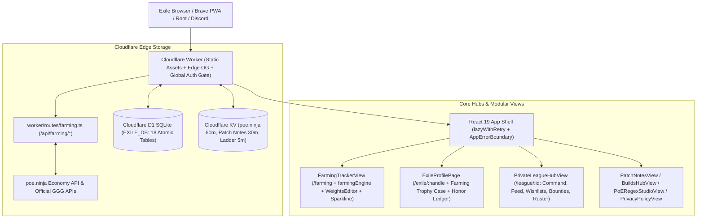

# EXILE SSF: Path of Exile 1 & 2 Compendium, Farming Tracker, and GSF Portal

<div align="center">

```text
  ███████╗██╗  ██╗██╗██╗     ███████╗    ███████╗███████╗███████╗
  ██╔════╝╚██╗██╔╝██║██║     ██╔════╝    ██╔════╝██╔════╝██╔════╝
  █████╗   ╚███╔╝ ██║██║     █████╗      ███████╗███████╗█████╗  
  ██╔══╝   ██╔██╗ ██║██║     ██╔══╝      ╚════██║╚════██║██╔══╝  
  ███████╗██╔╝ ██╗██║███████╗███████╗    ███████║███████║██║     
  ╚══════╝╚═╝  ╚═╝╚═╝╚══════╝╚══════╝    ╚══════╝╚══════╝╚═╝     
```

**Live Domain:** [exilessf.app](https://exilessf.app) • **Platforms:** Path of Exile 1 (3.30 Covens of Umbra) & Path of Exile 2 (0.5 Return of the Ancients)

[](https://exilessf.app)
[](https://developers.cloudflare.com/d1/)
[](https://vitejs.dev)
[](https://react.dev)
[](https://www.typescriptlang.org)
[](https://tailwindcss.com)
[](https://www.pathofexile.com/umbra)
[](https://pathofexile2.com/ancients)

</div>

## Executive Overview

**EXILE SSF** ([exilessf.app](https://exilessf.app)) is a dual game **Path of Exile 1 and Path of Exile 2** Solo Self Found compendium, **Farming & Drop Tracker**, and **Cloudflare D1 (SQLite)** powered **Private League Hub** engineered for both solo players and cooperative Group Self Found (GSF) communities.

Built to serve as a fast second monitor companion, **EXILE SSF** combines live stash dump tab diffing, customizable `SSF Utility` and `poe.ninja` drop tiering, local `Client.txt` map speed telemetry, official GGG patch notes, unified community builds, `poe.re` / `poe2.re` regex tooling, dedicated Exile Profiles (`/exile/:handle`), and hardened HMAC signed session security.

## Core Capabilities and Feature Modules

### 1. Farming & Drop Tracker (`/farming`)
Modular second monitor dashboard (`FarmingTrackerView.tsx` + `src/components/farming/*` + `worker/routes/farming.ts`) designed for SSF and GSF mapping productivity:
* **Compact 2 Card Summary & Stash Rail**: Displays **Wealth & Pace** (`Total | Hourly`, Strategy tag, `Maps/hr`, SVG Area Sparkline chart) and **Category Breakdown** (`Divines / Points | Percentage`) above a vertical colored Stash Tab rail (`Tabs | History | Stats`) and a dense sortable table (`Table | Bracket Cards`).
* **15 Stash Tab Live Scanner & Progress Indicator**: Select up to **15 Dump & Specialty Tabs** with live per tab scanning progress (`Scanning tab 4 of 15...`), Before/After session diffing, **Auto Pull (`15m / 30m / 60m`)**, **Focus Mode**, and a **Direct Browser JSON Fallback** (zero `POESESSID` required).
* **Dual Value System (`SSF Utility` | `poe.ninja`) & Custom Weights Editor**: Live 60 minute cached `poe.ninja` pricing with automatic **S / A / B / C Tiering**, plus an editable **SSF Weights** drawer (`WeightsEditorDrawer.tsx`) for customizing category multipliers, Wishlist bonuses, and exact item price overrides.
* **Deep Gem & Equipment Bracket Sorting**: Parses Gem **Level**, **Quality %**, **Vaal**, **Transfigured**, **Awakened**, and **Corrupted** tags alongside Equipment defense brackets (**Armour, Evasion, Energy Shield, Hybrid, Ward, Weapons, Jewellery, Jewels, Flasks**).
* **Live `Client.txt` Watcher (100% Browser Local)**: Attaches directly to your Steam or Standalone `Client.txt` (with copyable folder path helpers) to poll Maps Run, Pace, Deaths, and Current Zone every 15 seconds without uploading files.
* **Cloudflare D1 Cloud Stash & `.xlsx` Export**: Automatically persists synced stash state (`farming_stash_state`) and saved sessions (`farming_sessions`) to Cloudflare D1 across devices, with Strategy Leaderboards, Direct Wishlist Claim, `+ Free Stash` sharing, League Feed recaps, opt in desktop drop notifications, and multi tab `.xlsx` export.
* **Clear Demo Preview Mode**: First time visitors can click **Load Sample DEMO Data** (explicitly badged as `DEMO DATA`) to explore tiering and filters before importing their own stash.

### 2. Private League Hub (`/privateleaguehub` & `/league/:id`)
Universal cooperative GSF hub for hosting and managing any Path of Exile 1 or Path of Exile 2 private league:
* **Command Center & Live Feed (`/feed`)**: League Firsts Hall of Fame, crowdfund progress, Likes, inline shoutout comments, unread `X new` badge, and Discord/Root webhook alerts.
* **Wishlists, Free Stash & Loot Filter Generator**: 28 category item taxonomy, `Ctrl+C` tooltip parser, Path of Building wishlist importer (`pako`), reverse Free Stash Feed, and `.filter` block generator.
* **Bounties, Boss Rotas & Legacy Honors**: Prominent command ribbon sub navigation uniting Active Bounties, Boss Carries & Vouches, Fulfilled Wishes & Heroes, and persistent cross season Achievements & Honor Points.
* **Roster, Squad Atlas Matrix & Official Ladder Sync**: Account based slots with multi character tracking, 10 mechanic Squad Atlas Matrix, 10 minute Cloudflare Cron official ladder sync, and zero dependency `.xlsx` Google Sheets export/import.

### 3. Universal Compendium & Daily Tools (PoE 1 & PoE 2 Parity)
* **Official Patch Notes (`/patch-notes`)**: Full width live GGG forum feed for PoE 1 and PoE 2 with a searchable **Grouped Expansion Dropdown** (`Expansion 3.30 Series`, `3.29`, etc.), Major Expansion pinning, and clean post body extraction.
* **Unified Builds Hub (`/builds`)**: Combines Community Guides, SSF Starters, Guide Ingestion, and PoB Build Doctor filtered by game and patch.
* **Regex Studio (`/regex`)**: Embedded `poe.re` (Vendor, Gems, Map Mods, Items, Heist, Bestiary, Tattoo, Runegraft, Ultimatum) and `poe2.re` (Waystones, Vendor & Items, Tablets & Relics) with personal saved regex presets.
* **Modernized Mechanics & Recipes**: PoE 1 & PoE 2 **Vendor Formulas** (with Salvage, Disenchanting, Reforging Bench & quick stash regexes), **Defenses Masterclass** (Interactive EHP & Mitigation Calculator for both 5x PoE 1 and 10x PoE 2 Armour curves + Red Map/Waystone checklist), **Offenses Masterclass** (6 Step Scaling Pipeline, Interactive Multiplier Sandbox, Ailments Reference), **Mechanic Cheat Sheets**, and **Crafting Bench & Stash**.

### 4. Dedicated Exile Profiles (`/exile/:handle`) & Privacy Policy (`/privacy`)
* **Cross Game Profiles**: `All Games | PoE 1 | PoE 2` switcher, Profile Studio (live avatar preview, Imgur normalization, title picker), **Farming Telemetry & Season Trophy Case** (Maps Blasted, Avg Pace, Top Strategy, Notable Unique Drops), Safe Mapping Regex Generator, Session Scratchpad, and Honor Points History Ledger.
* **Security & Privacy (`/privacy`)**: Strict HMAC SHA256 signed `HttpOnly; Secure; SameSite=Lax` `exile_session` cookie enforced globally on all state changing `POST`, `PUT`, and `DELETE` Worker routes, owner/admin profile and cloud stash verification, stateless memory only `POESESSID` handling, and automatic Vite chunk reload recovery (`lazyWithRetry` + `AppErrorBoundary`).

## Modular Architecture and Cloudflare D1 Edge Stack



### Key Directories

```text
exile-ssf/
├── public/
│   ├── manifest.webmanifest                # Standalone PWA installation metadata
│   ├── sw.js                               # Network first passthrough service worker
│   └── achievements/umbra-witch-330.jpg    # Custom 3.30 Coven of Umbra Witch Medallion
├── src/
│   ├── components/
│   │   ├── FarmingTrackerView.tsx          # Compact 2 card dashboard, 15 tab live scanner, 30m auto pull
│   │   ├── farming/
│   │   │   ├── farmingEngine.ts            # Types, SSF Utility & poe.ninja tiering, stash parser, Demo data
│   │   │   ├── WeightsEditorDrawer.tsx     # Transparent editable SSF multipliers & item price overrides
│   │   │   └── LootSparkline.tsx           # SVG Area chart for 30 minute Auto Pull checkpoints
│   │   ├── PatchNotesView.tsx              # Grouped expansion dropdown & full width GGG patch reader
│   │   ├── BuildsHubView.tsx               # Unified PoE 1 & PoE 2 Guides, Starters, Ingest & PoB Doctor
│   │   ├── PoERegexStudioView.tsx          # Embedded poe.re & poe2.re studio with saved presets
│   │   ├── PrivacyPolicyView.tsx           # Transparent data, POESESSID, Client.txt, and cookie policy
│   │   ├── ExileProfilePage.tsx            # Cross game /exile/:handle hub & Farming Trophy Case
│   │   ├── VendorRecipesView.tsx           # Modernized PoE 1 & PoE 2 Vendor / Salvage reference
│   │   ├── DefenseMechanicsView.tsx        # Interactive PoE 1 / PoE 2 EHP Calculator & SSF Checklist
│   │   ├── OffensesView.tsx                # Visual 6 step damage pipeline & multiplier sandbox
│   │   └── league/                         # Private League tabs, modals, and squad widgets
│   └── utils/
│       ├── spreadsheetEngine.ts            # Zero dependency styled multi tab .xlsx builder & CSV reader
│       ├── poeItemParser.ts                # Ctrl+C tooltip parser & PoB zlib XML extractor (named pako)
│       └── achievements.ts                 # Cloud achievement & retroactive Honor Ledger engine
├── worker/
│   ├── index.ts                            # Cloudflare Worker, Global Auth Gate, 18 table D1 schema, Cron
│   └── routes/
│       └── farming.ts                      # Modular /api/farming/* routes (Stash, poe.ninja, Cloud State)
└── wrangler.jsonc                          # Cloudflare Workers config (EXILE_DB D1, EXILE_KV, 10m Cron)
```

## Tech Stack

| Layer | Technology | Purpose |
| :--- | :--- | :--- |
| **Framework** | React 19.2 + TypeScript 6.0 | Strict type safe code split architecture with automatic chunk recovery |
| **Build Tool** | Vite 8.2 | Fast HMR and chunked production bundles |
| **Styling** | Tailwind CSS 3.4 | Unified dark obsidian utility theme |
| **Database** | Cloudflare D1 (`EXILE_DB`) | Atomic SQLite edge storage across 18 relational tables (`farming_sessions`, `farming_stash_state`, `wishlists`, `roster`, `profiles`, `activity_feed`, etc.) |
| **Cache & Cron** | Cloudflare Workers + KV (`EXILE_KV`) | Edge OpenGraph injection, 60m `poe.ninja` cache, 30m GGG patch cache, 10m Ladder Cron |
| **Security** | HMAC SHA256 `exile_session` | `HttpOnly; Secure; SameSite=Lax` cookies enforced on all state changing API routes |

## Local Development Setup

1. **Clone and install:**
   ```bash
   git clone https://github.com/Leuie/exile-ssf.git
   cd exile-ssf
   npm install
   ```
2. **Start local dev server:**
   ```bash
   npm run dev
   ```
3. **Verify TypeScript & build:**
   ```bash
   npm run build
   ```
